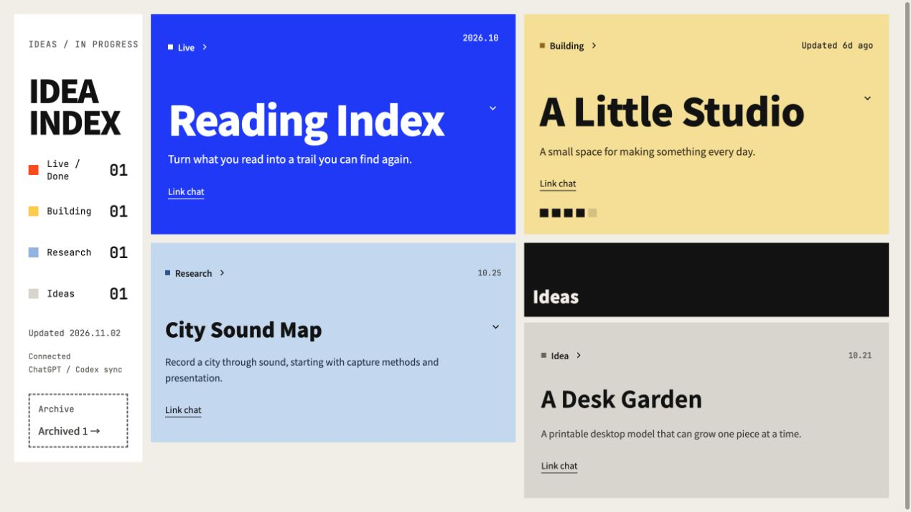
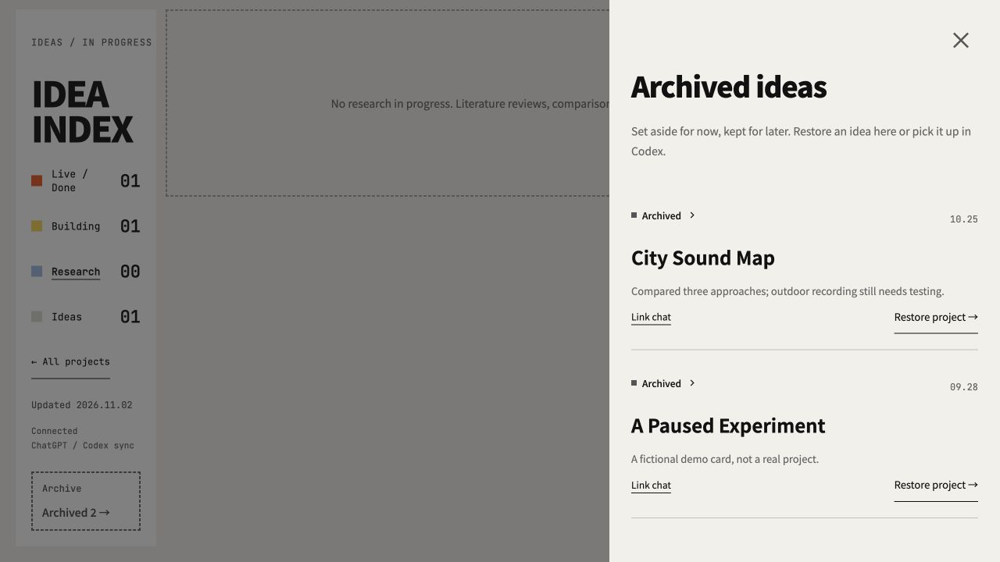

# Idea Flows Site

Lay out the work scattered across your AI chats.

[](https://github.com/patrlean/idea-flows-site/generate)
[](README.zh-CN.md)

## Why Idea Flows exists

Working with AI can mean five windows open at once: one fixing a bug, one building a page, one refactoring a backend, one researching a question, and another exploring an idea that just came to mind. Several tasks move forward together, while your attention keeps switching between them. Each return means finding your place again: the context, the progress, and the next step.

Idea Flows grew out of how disorienting and stressful that switching can feel. It **lays those scattered tasks out in front of you**, so you can see what is still an idea, what is being researched or built, what is finished, and where each task last moved forward. The goal is to help you stay oriented and feel less overwhelmed when working on many things with AI.

Automatic updates serve that goal. You should not have to remember every project's state or maintain another board by hand. Keep chatting and working; Idea Flows keeps an overview you can return to.

## Keep chatting. Status updates automatically.

Idea Flows is built around **automatic project status updates**. Discuss an idea, research a question, or build something: the agent in your conversation reads the actual progress, identifies the stage, and updates your board. You do not need to open the board, fill in progress fields, or move cards after each session.

Create your own Site and plugin with ChatGPT Sites, then choose how you work:

- **ChatGPT web chats:** connect your Site's plugin once, then **@mention your Idea Flows plugin** in the conversation you want to sync. Keep chatting; the agent finds existing projects and syncs grounded updates through the plugin. You do not need to call tools or supply status parameters yourself.
- **Codex:** connect [Idea Flows Hook](https://github.com/patrlean/idea-flows-hook), configure its scope, and trust the hooks once. Work normally in that scope. The active agent determines progress and the Stop hook sends it to your board, without repeated requests to update status.

**Set it up once, then keep working.** The author's local global-hook setup can cover new projects and chats; the current standalone public Hook release still requires directory enrollment and does not include discovery across every directory. Web syncing applies to chats where you @mention your Site's connected plugin, not all your ChatGPT conversations.

## Progress comes from the conversation

Ideas, active research, implementation, and verified delivery drive the corresponding board stages. Continuing a topic updates its existing card. A finished research report is not a launch, and archiving requires your explicit intent.

Card controls are **optional corrections**, not a routine maintenance task. If you explicitly choose a status yourself, subsequent automatic updates respect it.

Conversation buttons stay **below the short description and above expandable progress**, so opening a card does not move its link. The board reserves scrollbar space to keep column widths stable.

A real ChatGPT URL is reused within the same caller/session when the host supplies session metadata. Later links can fill earlier missing sources without rolling back progress or manual project states. If no real URL is available, `sourceLink.status: "missing"` explicitly reports it; provide the address once through `link_idea_chat`. Anonymous session IDs are never converted into chat URLs. An automatic update carrying a real URL can replace a legacy manual link marker; manual **project status** still takes priority.

## Preview

English interface with fictional demo projects. Screenshots are captured from the running app.



<details>
<summary>Archive and restore</summary>



</details>

## Start here

**Ask Sites to build your copy.** Open a Codex or ChatGPT Work chat with Sites available, then paste:

> @Sites Use https://github.com/patrlean/idea-flows-site as the template for my own Idea Flows site. Follow its AGENTS.md and docs/DEPLOY.md. Use the English interface (`language: "en"`), keep the existing layout, start with an empty board, create my own owner-private Site and storage, run the checks, and publish it. Return my verified Site URL and help connect its plugin. Do not reuse the template author's Site identity, data, or credentials.

Or click **Use this template**, create your own repository, and open it in Codex. [Deployment guide →](docs/DEPLOY.md)

You need access to Sites in your own account/workspace. Creating a GitHub copy alone does not publish a website. No model API key or separate model service is required by this application. [About Sites](https://developers.openai.com/training/walkthroughs/building-a-shareable-site)

## What you get

- 🗂️ **Five states** — Idea, research, development, live/completed, and archived.
- 🔄 **Automatic progress** — Conversation-driven status updates; card controls are optional corrections, archival, and restoration.
- ↗️ **Source links** — Open known ChatGPT conversations, local Codex chats/workspaces, and verified project websites.
- 🎞️ **Motion** — Animated category changes and card movement, with reduced-motion support.
- 💬 **Your Site's plugin** — Read and update your board through `list_ideas`, `sync_idea`, and `link_idea_chat`.
- 🔌 **Optional Codex hook** — A secret-protected receiver compatible with the separate public hook.
- 🧩 **A clean starting point** — No deployment ID, personal project catalog, chat history, or author credentials.

The interface supports English and Simplified Chinese. A fresh template defaults to English. UI language, branding, headings, date locale, and timezone are configurable; each README uses screenshots in its own language.

## Try it locally

Requires **Node.js 20+**. There are no npm dependencies to install.

```sh
git clone https://github.com/patrlean/idea-flows-site.git
cd idea-flows-site
npm run dev
```

Open the loopback URL printed in the terminal. The board starts empty. To preview fictional cards instead, stop that server and run:

```sh
npm run demo:en
```

Normal and demo data live in separate ignored `.local/` files. Deployment artifacts never include local/demo records. A newly provisioned Site starts empty; redeploying an existing Site preserves its hosted state.

## Make it yours

```sh
npm run setup -- --title 'My Ideas' --language en --timezone 'UTC'
```

Or edit [site.config.json](site.config.json). Layout and interactions live in `web/`; API and MCP tools live in `worker/index.js`. Set `language` to `en` or `zh-CN` to choose the interface language. `locale` affects only date formatting. Your own project content is never automatically translated.

| File | Purpose |
| --- | --- |
| `site.config.json` | Name, UI language, optional custom copy, date locale, timezone. |
| `.openai/hosting.json` | Sites storage/MCP declarations; your deployment ID is added only after registration. |
| `AGENTS.md` | Instructions for the agent that creates and publishes your copy. |
| `docs/DEPLOY.md` | Sites publishing, plugin connection, optional hook setup, and access boundaries. |
| `examples/ideas.en.json` / `examples/ideas.json` | English / Chinese fictional data used only by local demo servers. |

### Reproduce the screenshots

```sh
npm run demo:en
# Or, for the Chinese interface and demo content:
npm run demo:zh
```

Each demo language has its own ignored local data file. Optional `heading`, `description`, `eyebrow`, and `locale` in `site.config.json` override translated defaults; explicit custom copy is kept as written.

## Publish with Sites

The agent registers a fresh Site, persists its exact returned `project_id`, and follows the Sites source/save/deploy workflow. The build emits `dist/server/index.js` and `dist/.openai/hosting.json`; Sites provisions the R2 binding and handles ChatGPT authentication. This is a server application, not a static GitHub Pages export.

```sh
npm run check
npm run check:publish
```

`check:publish` deliberately fails until you register your own Site. It helps prevent accidental reuse of someone else's deployment. The tests and build work before registration.

New Sites should remain owner-private. Each Site is one shared board: anyone allowed into it shares its board API permissions. This is a personal/team starter, not a multi-tenant service with per-user isolated data.

## Connect the hook

For ChatGPT web updates, connect your Site's plugin once, @mention it in the conversation, and chat normally. The agent handles the synchronization tools. For automatic progress in Codex, install [Idea Flows Hook](https://github.com/patrlean/idea-flows-hook), then follow [the connection guide](docs/DEPLOY.md#optional-native-codex-hook) to configure **your own** `/api/sync` URL, runtime sync secret, and Sites service access. No credential is included in this template.

Both integrations understand `idea`, `research`, `dev`, `live`, and `discarded`. Research completion is not a launch; archiving needs explicit user intent. Manual state takes priority over routine automatic updates.

## Development

```sh
npm run check
```

Includes Node tests for authentication, empty initial state, public-hook onboarding, research, idempotency, concurrency, manual-state precedence, verified delivery, chat links, config escaping, and the publication guard. CI is configured for Node 20/24 on Linux, macOS, and Windows. Local checks do not prove that a new user's hosting/account setup is available; verify their actual publication separately.

MIT · Built by [patrlean](https://github.com/patrlean)
