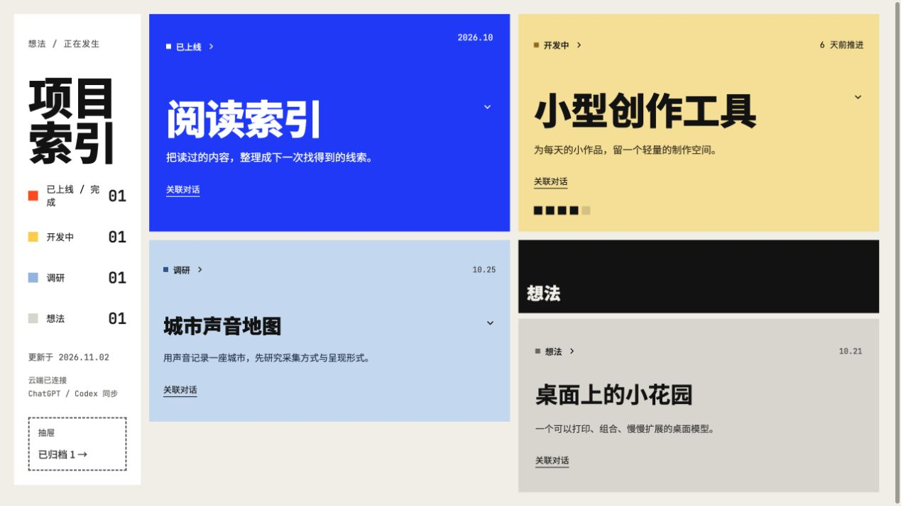
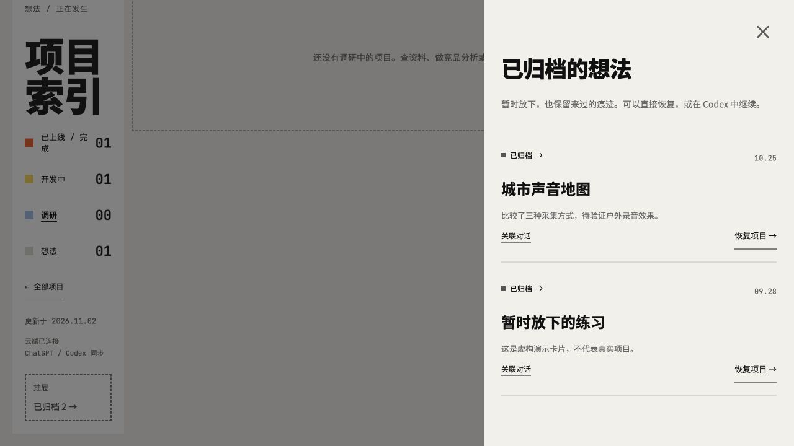

# Idea Flows Site

把散落在 AI 对话里的任务，摊开在你面前。

[](https://github.com/patrlean/idea-flows-site/generate)
[](README.md)

## 为什么做 Idea Flows

这个项目不仅仅是个任务自动看板，它其实源自于 AI 时代多任务切换时带来的眩晕和焦虑感。

你可能在笔记本电脑上同时开着 5 个窗口，一个在修 bug，一个在写页面，一个在重构后台系统，一个在探索突然进到脑子里的 idea，还有一个你也不知道在干啥

于是注意力在不断的任务切换之间，像国庆的 7 天假期一样悄悄地溜走

所以这个项目想把所有的任务平铺来，摊开在你的面前。希望能减少 AI 时代多任务切换带给你的压力。

## 正常对话，状态自动更新

Idea Flows 的核心是**不需要用户手动维护项目状态**。你只需聊想法、做调研、推进项目，当前对话中的 Agent 会根据实际进展，自动识别阶段、生成摘要并同步到看板。无需每次打开看板、新建卡片、填写进度或切换状态。

用 ChatGPT Sites 生成自己的站点和插件，再选择适合你的对话入口：

- **ChatGPT 网页对话**：首次连接本站生成的插件后，在需要同步的对话中 **@你的 Idea Flows 插件**，然后正常聊天。Agent 通过插件读取已有项目并自动同步进展，用户无需手动调用工具或填写状态参数。
- **Codex**：接入 [Idea Flows Hook](https://github.com/patrlean/idea-flows-hook)，完成一次配置与 hook 信任后，在启用的范围里正常开发即可。每轮进展由当前 Agent 判断，Stop hook 自动发送到看板，无需反复要求“更新状态”。

**启用一次，之后正常对话。** 本机全局 hook 方案可覆盖新项目和新对话；但独立公开的 Hook 当前版本仍需登记目录，并未包含跨所有目录的全局自动发现。网页端只同步已 @本站插件的对话，不监听其他聊天。

## 状态由对话中的事实驱动

随口提出的方向、正在验证的问题、已经开始的实现和已验证的交付，分别形成想法、调研、开发和已上线／完成的进展。同一主题继续推进时更新原卡片。调研报告完成不等于上线，归档需要你明确表达意愿。

卡片上的状态、归档和恢复操作是**可选的纠正入口**，不是日常使用步骤。若手动指定过状态，后续自动同步会尊重该选择。

对话按钮固定放在**简介下方、可展开的详细进展上方**，展开卡片不会把按钮推走。页面预留滚动条空间，避免列宽和标题换行随展开变化。

当客户端提供会话元信息时，真实 ChatGPT 地址可在同一调用者的同一会话中复用；后补链接会补齐该会话里缺失的来源，不回滚进展或手动项目状态。若没有真实网址，同步结果通过 `sourceLink.status: "missing"` 明确提示，再用 `link_idea_chat` 补一次地址；不会把匿名会话编号拼成链接。携带真实地址的自动更新可以替换旧版手动链接标记，手动指定的**项目状态**仍然优先。

## 效果预览

中文界面，使用虚构演示项目。以下截图均拍摄自实际运行的应用。



<details>
<summary>归档与恢复</summary>



</details>

## 最快开始

在可用 **Sites** 的 Codex 或 ChatGPT Work 对话里复制下面这段：

> @Sites 请使用 https://github.com/patrlean/idea-flows-site 作为模板，创建我自己的 Idea Flows 站点。先阅读 AGENTS.md 与 docs/DEPLOY.md，界面使用简体中文（`language: "zh-CN"`），保留现有排版、五种状态、卡片操作和动画。新建属于我的独立站点与存储，首次使用空看板，默认仅我可访问。缺少必要的账户连接时再提示我，其他设置先用模板默认值。运行检查，通过 Sites 正式发布，验证实际网址和 MCP 工具后返回站点链接，并帮助连接本站插件。不要复用模板作者的站点 ID、项目数据或凭据。

也可以先点击 **Use this template → Create a new repository**，再用 Codex 打开自己的仓库。[完整发布指南 →](docs/PUBLISH.zh-CN.md)

需要你的账户或工作区可用 Sites。复制 GitHub 仓库本身不会自动部署网站；本项目不需要额外模型 API Key，也不附带托管账户或额度。[Sites 官方介绍](https://developers.openai.com/training/walkthroughs/building-a-shareable-site)

## 包含什么

- 🗂️ **五种状态**：想法、调研、开发中、已上线／完成、已归档。
- 🔄 **自动进展同步**：通过对话判断和更新状态，无需用户维护；卡片操作仅用于可选纠正、归档与恢复。
- ↗️ **来源跳转**：打开真实 ChatGPT 对话、本地 Codex 聊天／工作区和已验证的网址。
- 🎞️ **切换动画**：分类与卡片变化有过渡，尊重减少动态效果设置。
- 💬 **站点自己的插件**：读取想法、同步进展、补充对话关联。
- 🔌 **本机 hook 接收端**：可对接独立开源的 Idea Flows Hook。
- 🧩 **干净的初始环境**：不含作者的部署标识、个人卡片、聊天记录和凭据。

界面支持简体中文和英文，两个 README 分别使用对应语言的截图。新模板默认英文，可通过 `language` 配置中文；站点名称、左侧标识、标题分行、日期格式与时区均可调整。

## 本地运行

需要 **Node.js 20+**，没有 npm 依赖需要安装：

```sh
git clone https://github.com/patrlean/idea-flows-site.git
cd idea-flows-site
npm run dev:zh
```

打开终端输出的本机网址，首次为空看板。要看虚构演示卡片，先停止前一个服务，再运行：

```sh
npm run demo:zh
```

自己的本地记录与演示数据分开保存在 `.local/`，不进入 Git 或部署产物。部署产物不含本地记录；新站点从空看板开始，已有站点重新部署时保留云端记录。

## 换成自己的名字

```sh
npm run setup -- --title '我的想法' --language zh-CN --timezone 'Asia/Shanghai'
```

也可以直接编辑 [site.config.json](site.config.json)。`language` 选择 `zh-CN` 或 `en`；`locale` 只控制日期格式。你自己的项目名称和内容不会被自动翻译。

| 位置 | 用途 |
| --- | --- |
| `site.config.json` | 名称、界面语言、自定义文案、日期格式与时区。 |
| `.openai/hosting.json` | 存储和 MCP 声明；新建站点后再保存自己的部署 ID。 |
| `AGENTS.md` | 让 Codex / Sites 理解如何生成和发布站点。 |
| `docs/DEPLOY.md` | 发布、插件连接、hook 对接与访问边界。 |
| `examples/ideas.json` / `examples/ideas.en.json` | 仅用于本地演示的中文／英文虚构卡片。 |

### 复现展示截图

```sh
npm run demo:zh
# 英文界面与演示内容：
npm run demo:en
```

两种语言的演示数据分别保存在忽略的本地文件中。未自定义的标题、描述和左侧标识会随语言切换；显式配置的文案保持原样。

## 发布为 GPT 站点

让 Sites 按仓库里的指引新建站点，保存实际返回的 `project_id`，通过源码、构建和部署流程发布。Sites 配置独立的 R2 存储并处理 ChatGPT 身份认证。

```sh
npm run check
npm run check:publish
```

模板尚未登记站点时，`check:publish` 会按设计报错；先让 Sites 创建你的站点。普通测试和构建不需要部署 ID。这是有服务器 API 的应用，不能只上传到 GitHub Pages。

默认保持站点仅自己可访问。一份站点对应一份共享看板：允许访问的人共享看板和操作权限，不是每个人独立隔离的 SaaS 产品。

## 连接 Codex hook

在 ChatGPT 网页端，首次连接站点生成的插件后，在对话中 @该插件并正常交流即可；同步工具由 Agent 自动调用。要在 Codex 中自动记录进展，再安装 [Idea Flows Hook](https://github.com/patrlean/idea-flows-hook)，按 [连接指南](docs/DEPLOY.md#optional-native-codex-hook) 配置自己站点的 `/api/sync`、同步密钥和 Sites 服务访问凭据。

调研完成不等于上线；已上线必须有验证依据；归档需要用户明确指令；手动状态优先。

## 开发检查

```sh
npm run check
```

包含认证、空看板、首次 hook 同步、调研状态、去重、并发、手动状态优先、交付验证、对话关联、配置转义与发布前检查。CI 配置覆盖 Linux、macOS、Windows 的 Node 20/24。每个使用者仍需单独验证自己站点的真实部署结果。

MIT · [patrlean](https://github.com/patrlean)
